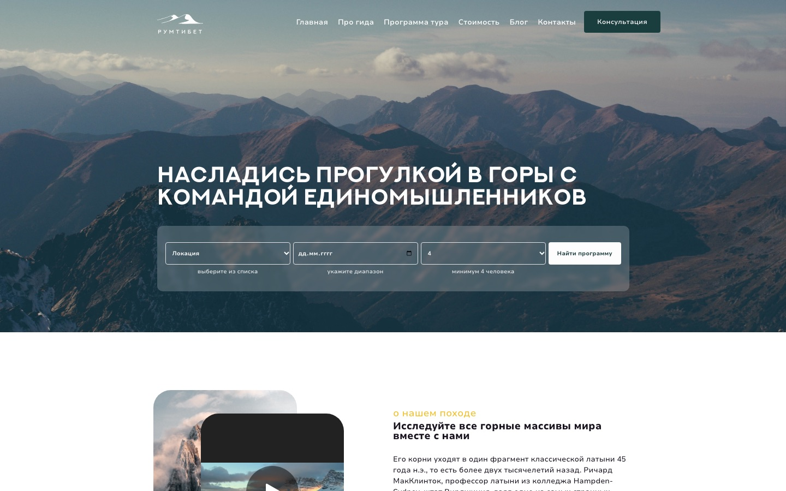

# РумТибет — лендинг турфирмы

Адаптивный лендинг турфирмы, которая возит в походы по Тибету и Гималаям. Написан на Vue 3 + Vuex.

**[Демо →](https://tibet-pi.vercel.app/)**



## Что внутри

- **Три брейкпоинта** — мобильный (< 640), планшет (640–1024) и десктоп. Отдельные картинки под мобильную и десктопную версии через `<picture>` и миксин `viewportWidth`
- **Популярные направления** — Swiper с виртуальными слайдами, навигацией, клавиатурой и бесконечной прокруткой. По клику открывается подробная карточка направления
- **Блог и галерея** — на мобильном это слайдеры, на больших экранах сетка
- **Форма поиска тура** — на мобильном раскрывается в отдельную панель, на десктопе это строка с полями
- **Подписка на рассылку** — валидация email и согласия с условиями, состояние отправки
- **Свой UI-кит** — `MainButton`, `MySelect`, `SectionTitle`, `CloseButton` регистрируются глобально
- **Контент в Vuex** — направления, блог, галерея и футер лежат в отдельных модулях стора, компоненты только отображают данные
- **Директивы** `v-click-outside` и `v-parallax` (параллакс фона с настройкой скорости и ограничений)

## Стек

Vue 3 (Options API), Vuex 4, Swiper 11, SCSS, Vue CLI 5, ESLint + Prettier

## Запуск

```bash
npm install
npm run serve     # dev-сервер на http://localhost:8080
npm run build     # продакшен-сборка в dist/
npm run lint      # проверка ESLint
```

## Структура

```
src/
├── components/        # секции страницы и карточки
│   └── UI/            # глобальные UI-компоненты
├── store/             # Vuex-модули с контентом
├── mixins/            # viewportWidth, toggleMixin
├── directives/        # v-click-outside, v-parallax
├── utils/linkCreator.js   # подключение картинок по соглашению об именах
└── assets/            # шрифты, картинки, общие стили
```

## Деплой

Сайт деплоится на Vercel: `vercel.json` собирает проект из исходников через `@vercel/static-build`, поэтому папка `dist` в репозиторий не коммитится.
